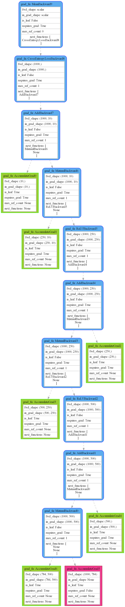

# Torchic
Torchic is a Deep Learning framework written in Python. It uses **NumPy** (for CPU) and **CuPy** (GPU) for underlying array operations. It's **designed after PyTorch** for educational purposes.


## Table of Contents
- [Torchic](#torchic)
  - [Table of Contents](#table-of-contents)
  - [Introduction](#introduction)
  - [Installation](#installation)
  - [Example of usage](#example-of-usage)
    - [Creating a Tensor](#creating-a-tensor)
    - [Tensor operations and autograd](#tensor-operations-and-autograd)
    - [Building a Neural Network](#building-a-neural-network)
  - [Performance](#performance)
  - [Acknowledgements](#acknowledgements)


## Introduction
Torchic aims to reproduce the complexity of PyTorch while trying to remain small and simple.
It shares a very similar autograd system based on a direct acyclic graph (DAG). Given two tensors, when certain requirements are achieved (at least one of the parents is float, has `requires_grad=True` and autograd is on), any operation will produce a new node on the computational graph. When `.backward()` is called on a non-leaf tensor, the graph is explored from root to leaves using a stack (Last-In First-Out). At each node, the corresponding gradient is computed, multiplied for the previous one and passed to the next.
An internal reference count is used in order to manage cases where one tensor has multiple children (eg. Transformer's attention mechanism). In this case, the gradient is temporarily accumulated and the exploration resumes to the next branch.

## Installation
Clone the repository and install it locally via `pip`:
```shell
git clone https://github.com/crick328/Torchic.git
cd Torchic
pip install .
```

Based on your needs, you can choose which modules to install.
If you want CUDA support, then write
```shell
pip install .[cuda]
```
_NOTE: to use CuPy, be sure to have installed CUDA from: [https://developer.nvidia.com/cuda-downloads](https://developer.nvidia.com/cuda-downloads)._
This will also install CuPy and enables some additional features.
If you would like to visualize the backward DAG, then write
```shell
pip install .[visual]
```
_NOTE: it uses Graphviz, which requires manual download of the engine. For more info, visit [https://pypi.org/project/graphviz/](https://pypi.org/project/graphviz/)._

If you desire to install both packages, you can also write
```shell
pip install .[full]
```


## Example of usage
For the vast majority of cases, Torchic shares PyTorch's syntax, behavior and package structure.


### Creating a Tensor
A new tensor can be created from a list or a numpy array as follows:
```python
from torchic import tensor, Tensor
import numpy as np

data = np.random.rand(20, 10)

tensor_a =  Tensor(data, requires_grad=True, device="cpu", dtype=None)
tensor_b = Tensor([1, 2, 3])
# function made to match PyTorch's API. It wraps Tensor's constructor
tensor_c = tensor([1., 2., 3.])

# dtype is inferred from the given data if not given
print(tensor_b.dtype) # -> int32
print(tensor_c.dtype) # -> float32
```


### Tensor operations and autograd
A simple operation between tensors can be done as follows:
```python
from torchic import rand
from torchic.settings import set_default_device, set_default_precision


set_default_device("cpu")   # "cuda" usable if installed. Default is "cpu"
set_default_precision(64)   # default is 32

a = rand((100, 20), requires_grad=True)
b = rand((20, 30))

print(a.is_leaf, b.is_leaf) # -> True, True
print(a.grad_fn, b.grad_fn) # -> None, None

c = a @ b
print(c.is_leaf)            # -> False
print(c.grad_fn)            # -> MatmulBackward0

c.mean().backward()
# tensor "a" has grad because a.requires_grad=True, while
# tensor "b" doesn't because not required
print(a.grad.shape(), b.grad) # (100, 20), None
```

If you have installed the package for visualization, you can use `draw_graph()` to see
<details>
<summary><b>what happens under the hood</b></summary>
<br>
<p align="center">
  
</p>
</details>


### Building a Neural Network
Declaring a neural network is also identical to PyTorch:
```python
from torchic import nn

model = nn.Sequential(
    nn.Linear(28*28, 100),
    nn.ReLU(),
    nn.Linear(100,10),
    nn.Softmax(dim=-1)
)
print(model)
# -> Sequential(
#      (linear0): Linear(n_input=784, n_output=100, bias=True)
#      (relu1): ReLU()
#      (linear2): Linear(n_input=100, n_output=10, bias=True)
#      (softmax3): Softmax()
#    )
```
Models can be saved, previewed and loaded in a safe way thanks to the `safetensors` format:
```python
from torchic.nn.models.save_load import save, load_architecture, preview_safetensor

save(model, filename="test_model")
preview_safetensor("test_model.safetensors")
# -> Tensors         Shape           Precision      
#    linear0.bias    (100,)          float64        
#    linear0.weights (784, 100)      float64        
#    linear2.bias    (10,)           float64        
#    linear2.weights (100, 10)       float64 
load_architecture("test_model")
```
A complete example of training loop can be seen in [test_train_MNIST.py](./testV2/test_train_MNIST.py).


## Performance
While Torchic is born only as a way to learn, it's constantly under optimization. I do my best to make it faster and with a smaller memory footprint. It's even comparable to PyTorch for simple scenarios such as MNIST, but I never got faster than them even if their code is much larger and complex than mine. Congratulations for their great work!

Optimizations are still a fundamental aspect because I want to train a Small Language Model with my library. The bigger the model and the dataset, the better. I already have implemented the 2017 Transformer of the paper "Attention is All You Need" following the implementation and explanation of [Umar Jamil](https://github.com/hkproj) with his [3h long YouTube video](https://www.youtube.com/watch?v=ISNdQcPhsts) plus [another](https://www.youtube.com/watch?v=bCz4OMemCcA) where he focuses on the theory. Even for this "base" model, optimizations are essential to have a reasonably-long training time which allows for experiments and testing on the hardware at my disposal. 


## Acknowledgements
Shoutout to the entire PyTorch engineering team. All of my work is based on their library. Benchmarking "against" them is always interesting because I have an idea of the enormous work they have done. They cover a lot of edge cases and have a lot of implementations, but their code still run faster than mine everytime.

Shoutout to the NumPy and CuPy teams, which allowed me to focus on the framework instead of implementing everything from scratch (which I _shortly_ tried to do).

Shoutout to [Umar Jamil](https://github.com/hkproj) (primary source for the Transformer implementation) and all the other content creators that offered in-depth explaination of the architecture.
